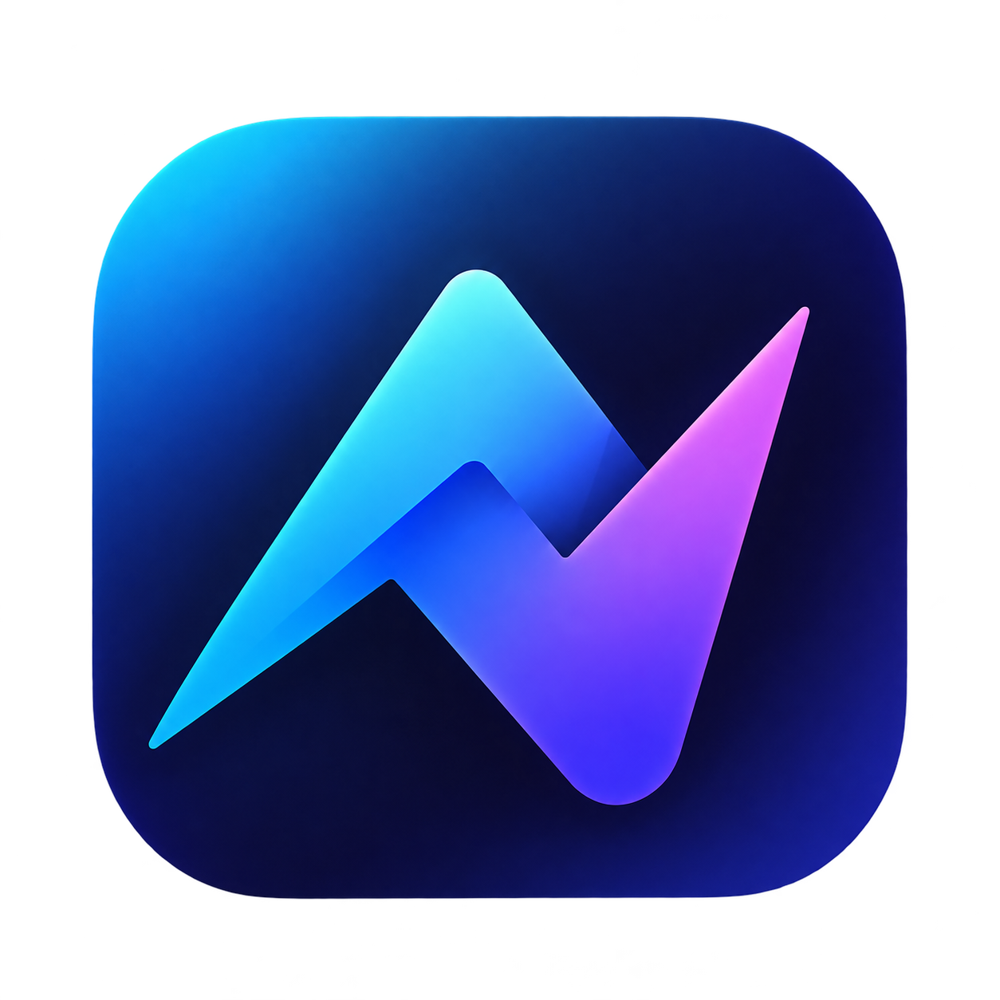

# Blitz Neo



Blitz Neo is an independently maintained macOS developer workspace by AmoSystems,
based on [Blitz](https://github.com/blitzdotdev/blitz-mac). It combines App Store
Connect management, an integrated coding terminal, MCP tools and simulator
controls. This is an independent maintenance fork, not an official Blitz successor.

**[Download the latest release](https://github.com/MrFam0s/blitz-mac/releases/latest)**
for Apple Silicon Macs. Releases are distributed through GitHub,
not the Mac App Store. Read the release notes for the downloadable artifact,
verification results and known limitations.

[AmoSystems](https://amosystems.org/) ·
[Contributing](CONTRIBUTING.md) ·
[Release CLI and MCP](docs/release-workflow.md)

## Features

- App overview, version drafts, listing text, screenshots, pricing and review data.
- TestFlight builds, groups, beta information and feedback.
- Cached views and layouts that adapt beside the integrated terminal.
- German and English interface, following macOS or a selection in Settings.
- Project-specific simulator selection and device tooling.
- Coding assistants through the terminal and compatible MCP tools.
- Separate draft creation and an explicitly started publication workflow.
- A shared release CLI and MCP backend for existing development chats, with
  explicit app/platform/build selection and resumable submission records.
- Joint review of an app version and explicitly selected in-app purchases,
  subscriptions and subscription groups through that CLI/MCP workflow.
- One pinned ASC implementation shared by the app and its CLI wrapper.

## Install and connect

The public download targets **Apple Silicon (arm64), macOS 14 or later**. Intel
builds are not included. Full Xcode and the appropriate simulator runtimes are
needed for Apple app builds and simulator features. An internet connection is
required for Apple services and downloading any additional development tools.

1. Download the DMG from the [release page](https://github.com/MrFam0s/blitz-mac/releases/latest),
   open the download and drag **Blitz Neo.app** into **Applications**. Check that
   page for signing and notarization details.
2. Open `/Applications/Blitz Neo.app`, connect your own App Store Connect account
   and import a project. Some Apple operations also require an interactive web
   sign-in; the app cannot extend Apple's session lifetime.
3. Use **Settings → Integrations** to inspect the local MCP/CLI connection and
   copy configuration for your coding assistant. Your assistant needs its own
   installation, account and permissions.

Blitz Neo must be running for its release CLI and macOS MCP tools. The CLI is
available at `~/.blitz/bin/blitz-neo`; see the
[release workflow](docs/release-workflow.md) for requests and examples. A prepared
release does not submit itself. Final submission requires explicit confirmation
of the exact operation and passes the same checks through the UI, CLI and MCP.
Apple still decides whether to approve and publish the app.

The drag-and-drop app installs the native ASC and macOS MCP/CLI helpers on
launch. It does not install the optional iPhone MCP or `idb`, download simulator
runtimes, or change your selected Xcode. Existing developer setups remain usable;
a fresh Mac needs those optional device dependencies configured separately.
Project-specific simulators and parallel development remain supported. Multiple
simulators can share one installed runtime.

For simulator control from a chat, install the matching Xcode simulator runtime,
the `idb` CLI and `idb_companion`. If you already have the [Blitz Node runtime](docs/node-toolchain.md),
install or update the iPhone MCP from the downloaded app, then reconnect your MCP client:

```bash
resources="/Applications/Blitz Neo.app/Contents/Resources"
bash "$resources/pkg-scripts/install-iphone-mcp.sh" "$HOME/.blitz/node-runtime" "$resources"/iphone-mcp/*.tgz
```

Select the project's simulator with `blitz_macos.simulator_select_device` and pass its UDID to
`blitz-iphone` for taps, swipes and screenshots. On iPhone Duo, `blitz_macos.simulator_set_pose`
changes the fold position using macOS Accessibility permission. `get_screenshot` captures the
active display. If your Codex configuration has an `enabled_tools` list for `blitz_macos`,
include `simulator_set_pose` there to expose it to the chat.

To update, quit Blitz Neo and replace it using the latest DMG. The current in-app
updater does not install DMG downloads; a regular GitHub release does not change
that installation method.

## Identity and existing installations

The app is **Blitz Neo**, with bundle ID `org.amosystems.BlitzNeo`, installed as
`/Applications/Blitz Neo.app`. The internal Swift executable is still `Blitz`.

Existing `~/.blitz` projects, settings, CLI wrappers, Keychain service names and
MCP server names (`blitz_macos`, `blitz-iphone`) remain stable for compatibility.
Selected UI preferences and window layout migrate once from `com.blitz.macos`;
existing Neo preferences take precedence. Existing cache directories are retained.

macOS sees the new bundle identifier as a new app. Screen Recording,
Accessibility and Keychain access may require renewed user consent, and Apple's
web login may need to be completed again. Permissions are not bypassed or reset.
Quit an existing Blitz Neo instance before replacing its app bundle. Keep your
project folders and `~/.blitz` data when updating.

## Build and test

See [MAINTENANCE.md](MAINTENANCE.md) for the exact pinned toolchain, helper
provenance, validation history and platform-specific limitations.

Source builds require Xcode with the macOS SDK and Swift tools, Python 3,
**Go 1.27.4 or newer** as required by the pinned ASC `go.mod`, and the exact
**Node 26.13.1 / npm 12.2.2** pair in
[config/node-toolchain.json](config/node-toolchain.json). See
[Node setup](docs/node-toolchain.md) for toolchain selection. `GO` can select a Go
executable; `BLITZ_NODE_BIN` can select the Node/npm `bin` directory. The resolver
checks these versions and does not install missing tools.

```bash
git clone --branch maintenance/auth-and-tooling https://github.com/MrFam0s/blitz-mac.git
cd blitz-mac
git submodule update --init --recursive

# Verified compatibility workflow with Xcode 27.
swift test --build-system native --jobs 4
BLITZ_SWIFT_BUILD_SYSTEM=native BLITZ_BUILD_JOBS=4 bash scripts/bundle.sh release
open ".build/Blitz Neo.app"
```

The native build engine is a local compatibility fallback. A normal SwiftPM
build may be used with the appropriate Xcode toolchain components installed.
The bundle is ad-hoc signed unless `APPLE_SIGNING_IDENTITY` selects your own
Developer ID identity. Signing does not notarize or publish the app.
Maintainers can prepare a signed DMG with `npm run release`; see
[public release preparation](docs/public-release.md). That command does not bump
versions, tag, push or publish anything.

The ASC helper is built from the pinned official source with the protocol adapter
in [helpers/asc-overlay](helpers/asc-overlay/README.md). Do not substitute an
ordinary standalone ASC binary. The app and terminal share the same helper.
The bundle script also builds and tests the maintained iPhone MCP from its pinned
source; source builds download dependency packages as needed.

GitHub Actions remain paused/manual for this fork. Local checks are the active
validation route. Contributions do not require paid GitHub features or hosted
macOS runners. See [CONTRIBUTING.md](CONTRIBUTING.md) for the review workflow.

## Data and privacy

Settings, registered-project links, tools, logs and release operation records are
stored locally under `~/.blitz`. Imported project source stays in its original
folder, with Blitz metadata in `.blitz/project.json`. The app also uses standard
macOS preferences and cache directories. Registered projects receive managed
assistant instructions and skills; see [release routing](docs/release-workflow.md).

Store data is requested from Apple for the selected account. Authentication uses
Keychain and private local credential/session files. These files, local state and
verification logs must not be committed or included in public bug reports. Coding
assistants use their own account, network and permission settings.

Maintenance builds do not embed analytics configuration. The old community App
Wall has been removed. Existing MCP transport names and local paths remain
unchanged to keep configured clients working.

## Attribution and license

Blitz Neo modifies Blitz by Minjune Song and Palash Bansal. The original copyright
and attribution notices are retained in [LICENSE](LICENSE) and [NOTICE](NOTICE).
This repository is licensed under Apache 2.0. Third-party helpers retain their own licenses;
see their respective source and overlay documentation.

The new icon is an original generated concept adapted for this fork. Its production
asset and generation details are documented in [branding/README.md](branding/README.md).
Use of a new name does not imply endorsement by the original authors or Apple.
